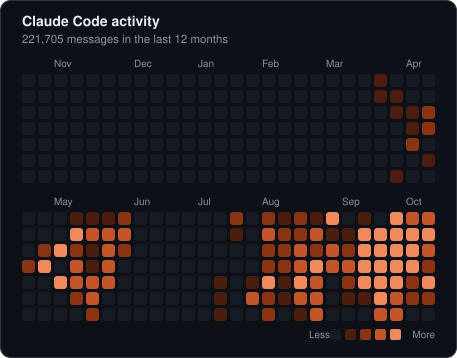
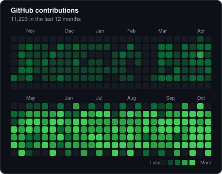

  

  
  
  

<h1 align="center">Welcome to my GitHub! 👋</h1>

  

  

I'm **Yuri Bedran**, a **23-year-old Brazilian founder and software engineer**, building software since **2020**.

I co-founded **[Hubble](https://hubble-inc.com/)**, a software house focused on **finance**. We build **data platforms**, **automations and AI agents**, and **ERP integrations** for finance teams that are tired of spreadsheets, manual reconciliation and reports that arrive too late.

What I bring to the table is the mix. Finance isn't a domain I picked up for a project, it's the language I think in. I understand the full chain from transaction to financial statement: how entries flow into the general ledger, how a close gets consolidated across entities and ERPs, and how cash, margin and working capital tell the real story behind the P&L. Pair that with **TypeScript, Python and Java**, and we build software that runs a finance team's routine end to end, instead of software that only looks good in a demo.

<b>🚀 Companies I'm building</b>

 

| | Company | What it does |
|---|---|---|
| 🪐 | **[Hubble](https://hubble-inc.com/)** | Software house for finance: data platforms, AI agents, automations and ERP integrations. Home of products like GEDAII and Lastro. |
| 📈 | **[We Grow](https://bywegrow.com/)** | Growth partner for companies: lead generation engines, content operations and marketing automation. |
| 🎨 | **[Tarsi AI](https://www.tarsi-ai.com)** | SaaS that turns plain product photos into professional imagery, branding kits and product sites with AI. |
| ☕ | **[RAIBRA](https://raibra.com/)** | Digital marketplace for Brazilian specialty coffee: producers list their lots, buyers worldwide discover them and negotiate directly. |

<b>🌍 Languages I speak</b>

 

🇧🇷 Portuguese · 🇺🇸 English · 🇪🇸 Spanish · 🇮🇹 Italian · 🏛️ Latin

<!-- STACK:START -->

<b>🛠️ My Tech Stack</b>

<h4>💻 Languages</h4>

<h4>🎨 Frontend</h4>

<h4>⚙️ Backend</h4>

<h4>🗄️ Databases & Data</h4>

<h4>🧠 AI & LLMs</h4>

<h4>🤖 Automation</h4>

<h4>☁️ Cloud & DevOps</h4>

<h4>🧰 ERPs & Business Tools</h4>

<!-- STACK:END -->

## 📊 GitHub Activity

  

  

  
  

